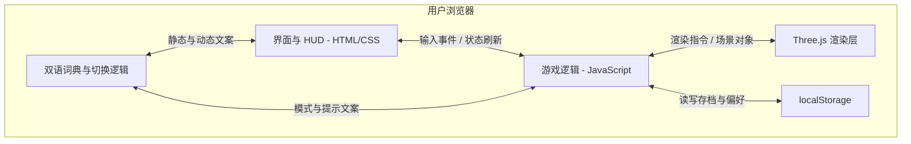

# 产品需求文档（PRD）— 星野漫游 / Starfield Drift

## 1. 产品概述

星野漫游是一款运行在浏览器中的 3D 星际探索体验：打开网页即可驾驶飞船，在由一颗恒星、六颗行星、三颗卫星与小行星带组成的星系中自由穿行，近距离观察程序化生成的行星表面，并随时暂停、随时继续。

它面向喜欢沉浸式漫游、但又不想下载安装包的用户（学生、设计爱好者、评审现场演示场景）。核心价值是**零安装成本 + 零任务压力**：没有倒计时、没有失败惩罚、没有强制目标，只有可自由探索的星空。

产品解决的问题：传统太空题材游戏体积大、上手门槛高、需要账号与长流程引导。本产品把"起飞即可探索"压缩成一次页面加载。

## 2. 需求约束

- **浏览器可访问性**：在现代桌面与移动浏览器上通过 WebGL 流畅运行，无需插件、无需后端服务。
- **轻量 3D 性能**：行星、星云、飞船全部程序化生成，不依赖外部模型与贴图；首次加载只请求一个 HTML 文件与 Three.js CDN 资源。
- **输入响应**：桌面端支持键盘 + 鼠标（含指针锁定），移动端支持双虚拟摇杆与功能按钮，手感需要自然、低延迟。
- **本地持久化**：使用 `localStorage` 自动保存飞船位置、朝向、已发现天体与玩家偏好，不需要账号体系。
- **双语可用性**：界面文案支持简体中文与英文，默认简体中文；语言偏好随设置持久化并即时生效，无需刷新页面。

## 3. 核心功能

功能按开发阶段组织，标注优先级。

**阶段一：探索基础**
- **开放探索空间** [high] —— 玩家可自由飞行的星系空间。
  - 开放式星域：向任意方向自由飞行，可看到恒星、星云、行星、卫星与小行星带。
  - 天体集合：11 个可接近的天体（含母恒星、气态巨行星、带环行星、冰封世界、熔岩世界、海洋世界、雨林世界、沙漠世界、三颗卫星），各有独立的着色器外观与尺度。
  - 轻量 3D 场景：星云一次性烘焙为 cubemap，恒星为跟随相机的点精灵，保证首屏加载与逐帧开销都可控。
- **飞船操控** [high] —— 可驾驶并接近天体的飞船。
  - 全向飞行：前进/后退、左右平移、上升/下降、偏航/俯仰/翻滚。
  - 接近天体：可贴近行星观察地表细节，接近时自动限速并施加软碰撞，避免穿模。
  - 速度反馈：HUD 实时显示速度数值与推进条，并区分巡航 / 加速 / 限速状态。

**阶段二：界面与导航**
- **HUD 信息层** [medium] —— 飞行时叠加在画面上的导航信息。
  - 最近天体：显示名称、类型、所属母星与距离；进入范围时高亮。
  - 速度指示：当前速度（千米/秒）与推进条，加速时切换配色。
  - 坐标显示：X / Y / Z 三轴坐标，便于定位与演示。
  - 方位罗盘：顶部刻度带 + 航向角 + 俯仰角，随语言切换本地化方位名称。
  - 天体标记：屏幕内投影、屏幕外贴边并自动散开避免重叠；可一键隐藏。
- **天体发现提示** [medium] —— 首次进入某天体范围时弹出横幅（名称 / 类型 / 描述），并记录到已发现集合；重复进入有冷却，避免刷屏。

**阶段三：个性化与进度**
- **飞船选择** [medium] —— 三艘造型与定位不同的飞船（星矢：敏捷截击机；观澜：科考舱；长庚：远程探索舰），偏好保存在本地。
- **自动存档与续玩** [high] —— 无需账号即可续玩。
  - 自动保存：每 5 秒、进入新天体、暂停、页面隐藏/关闭时写入 `localStorage`。
  - 继续漫游：重新打开页面时恢复上次位置、朝向与已发现记录，并在菜单显示"上次保存时间 / 邻近天体"。
  - 重新开始：二次确认后回到起始位置并清空发现记录，避免误触丢失进度。
- **双语与设置** [high] —— 声音开关、Y 轴反转、HUD 亮度、语言切换，全部持久化。

## 4. 用户流程

1. **进入与选择**：打开页面 → 加载完成后进入菜单（相机环绕飞船）→ 选择飞船 → 点击"开始漫游"。若存在存档，主按钮为"继续漫游"。
2. **起飞与操控**：点击画面启用鼠标操控（桌面端）或直接使用双摇杆（移动端），根据 HUD 的速度、坐标与罗盘调整航向。
3. **接近天体**：飞向目标天体 → 进入范围时弹出发现横幅、罗盘与标记同步更新 → 接近到一定距离后自动限速，避免高速撞入。
4. **持续探索**：无时间限制、无失败状态，可随时切换飞船或调整设置。
5. **暂停与退出**：按 `Esc` / `P` 暂停，位置立即落盘；关闭标签页后再次打开，页面提示继续漫游并恢复现场。

## 5. 技术架构

纯客户端单页应用：无后端、无数据库、无构建产物。所有游戏逻辑、3D 渲染、界面与存档都在浏览器内完成。



说明：
- **界面与 HUD**：HTML + CSS 构建菜单、HUD 面板、罗盘、标记层与触控控件，使用 CSS 变量与安全区适配移动端。
- **Three.js 渲染层**：负责星云环境、行星着色器（单一材质按 `#define PTYPE` 分支）、大气壳、行星环、飞船程序化模型、尾焰、尘埃与光照。
- **游戏逻辑**：飞船动力学、软碰撞、天体扫描与区域判定、相机混合（追逐 / 环绕）、HUD 投影与自适应画质。
- **双语词典**：以 `I18N.zh / I18N.en` 两份键值表驱动，静态节点用 `data-i18n`，动态文案统一走 `t()`，支持 `{var}` 插值。
- **localStorage**：保存进度与偏好；启动时读取并恢复，语言切换立即落盘。

## 6. 本地存储结构

| localStorage 键 | 类型 | 说明 |
|---|---|---|
| `gameState` | JSON 对象 | 飞船位置、朝向、保存时间与已发现天体 |
| `playerSettings` | JSON 对象 | 飞船选择、声音、HUD 亮度、Y 轴反转、语言 |

**`gameState` 结构**
```json
{
  "position": { "x": 0, "y": 0, "z": 0 },
  "rotation": { "x": 0, "y": 0, "z": 0 },
  "lastSaved": "2026-11-26T10:30:00.000Z",
  "discovered": ["samudra", "candra", "karang"]
}
```

**`playerSettings` 结构**
```json
{
  "selectedShip": "ship_01",
  "soundEnabled": true,
  "hudOpacity": 0.8,
  "invertY": false,
  "lang": "zh"
}
```

读写均为同步操作（`localStorage` 本身为阻塞式），触发点为：启动读取、每 5 秒定时保存、进入新天体、暂停、页面隐藏 / 关闭、语言与设置变更。数据不加密，仅用于同一台设备上的连续性体验；不采集任何个人信息。

## 7. 技术栈

- **基础技术**：HTML5、CSS3、原生 JavaScript（ES Module）——无框架、无打包器。
- **3D 引擎**：Three.js 0.187.0，通过 jsDelivr ESM 引入，并配置 jsDelivr 备用路径与 unpkg 兜底，保证单点 CDN 故障时仍可加载。
- **界面样式**：原生 CSS（自定义属性、Grid、Flexbox、`env(safe-area-inset-*)`），无 UI 框架。
- **程序化资源**：行星、环、大气、星云、飞船、尾焰、尘埃、面板与涂装纹理均由 GLSL / Canvas 在运行时生成。
- **数据存储**：浏览器 `localStorage`。
- **部署**：静态托管（GitHub Pages / Netlify / Vercel / 任意静态服务器），或使用仓库内 `Dockerfile`（nginx 托管单个 `index.html`）。
- **本地预览**：`python -m http.server 8931 --bind 127.0.0.1`（必须通过 HTTP 打开，ES Module 不支持 `file://` 直开）。
